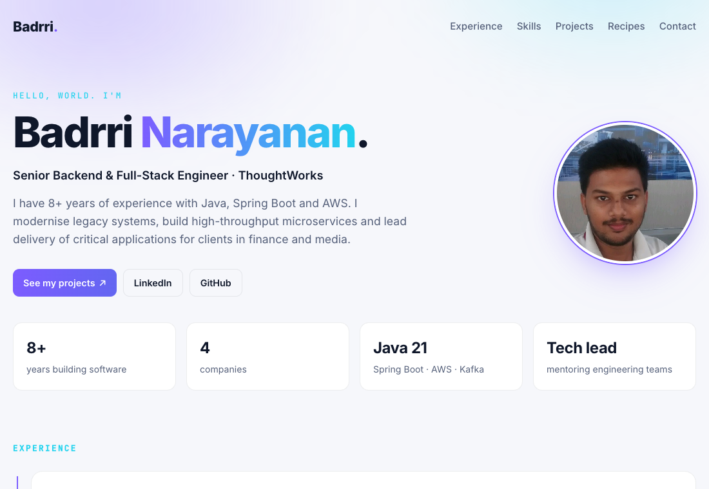

# Badrri Narayanan · Portfolio

My personal website: a one-page résumé, a showcase of projects I've built, a few small browser games, and a collection of South Indian recipes.

**[badrri-narayanan.github.io →](https://badrri-narayanan.github.io/)**

<p align="center">
  
</p>

## What's on the site

| Page | Path | What it is |
| --- | --- | --- |
| Home / résumé | [`/`](https://badrri-narayanan.github.io/) | Introduction, experience timeline, skills, education and contact details |
| Projects | [`/myprojects.html`](https://badrri-narayanan.github.io/myprojects.html) | Cards for back-end and front-end projects with live demo and source links, filterable by type |
| Small experiments | [`/myprojects.html`](https://badrri-narayanan.github.io/myprojects.html) and [`/mini-projects/`](mini-projects/) | Rock Paper Scissors, an age and birthday calculator, and earlier React demos |
| Recipes | [`/recipes/`](https://badrri-narayanan.github.io/recipes/) | Searchable recipe collection, built from one JSON file per recipe |

## Tech

Plain HTML, CSS and JavaScript, with no framework, no build step and no dependencies. Fonts are Inter and JetBrains Mono from Google Fonts. The site is hosted on GitHub Pages.

## Run locally

```sh
python3 -m http.server 8000
# open http://localhost:8000
```

Use a local server rather than opening the files directly: the recipes page has to fetch its JSON files, and browsers block that for `file://` pages.

## Updating the site

Make changes on a `feat/…` branch, open a pull request into `master`, and merge it. GitHub Pages redeploys `master` automatically, usually within a minute or two.

### Add a project card

Copy this into the project grid in `myprojects.html`. Newest projects go first, after the featured card.

```html
<article class="card" data-tags="frontend live">
    <div class="card-top">
        <span class="icon" aria-hidden="true">🔑</span>
        <span class="status live">Live</span>
    </div>
    <h2>Project name</h2>
    <p>One or two sentences on what it does and why it's interesting.</p>
    <ul class="tags">
        <li>JavaScript</li><li>CSS</li>
    </ul>
    <div class="links">
        <a class="btn primary" href="https://badrri-narayanan.github.io/repo-name/" target="_blank" rel="noopener">Live demo</a>
        <a class="btn ghost" href="https://github.com/Badrri-Narayanan/repo-name" target="_blank" rel="noopener">View source</a>
    </div>
</article>
```

- `data-tags` controls which filter buttons show the card. Use any of `backend`, `frontend` and `live`, separated by spaces.
- For a project with no live demo, remove the `Live demo` button and `live` from `data-tags`, and change the badge to `<span class="status source">Source</span>`.
- For a smaller project, add an `<a class="mini-item">` link to the **Small experiments** list instead.

### Add a recipe

Add one JSON file to `recipes/data/`. No code changes are needed. See [`recipes/README.md`](recipes/README.md) for the format.

## Project structure

```
├── index.html               # home / résumé page
├── myprojects.html          # projects page
├── css/
│   ├── myprojects.styles.css   # shared design system (used by every page, including the games)
│   └── resume.styles.css       # extra styles for the home page
├── images/profile-pic.png
├── mini-projects/           # small browser games and tools
│   └── shared/              # shared game styles and confetti effect
├── recipes/                 # recipes page, its script and data/*.json
└── docs/screenshot.png      # image for this README
```

## License

© 2026 Badrri Narayanan S. All rights reserved. The content, résumé details and photos on this site are personal and may not be reused without permission.
